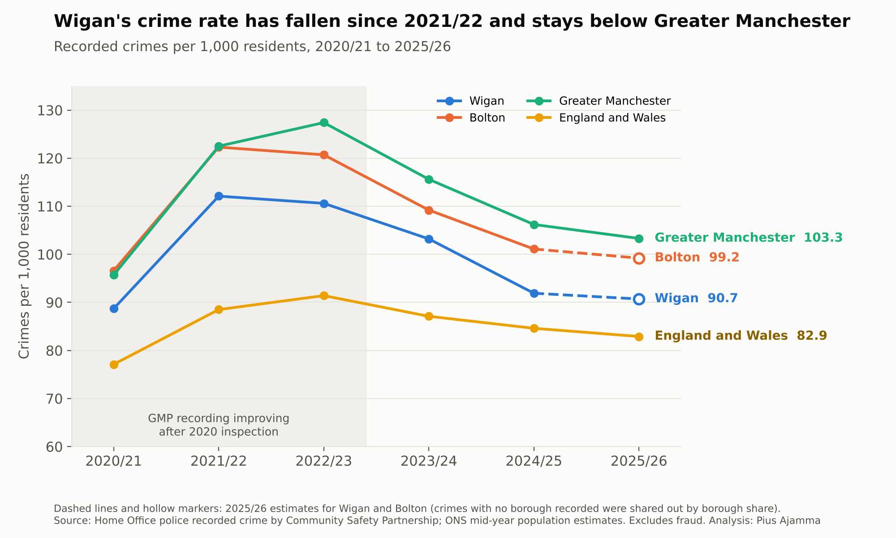
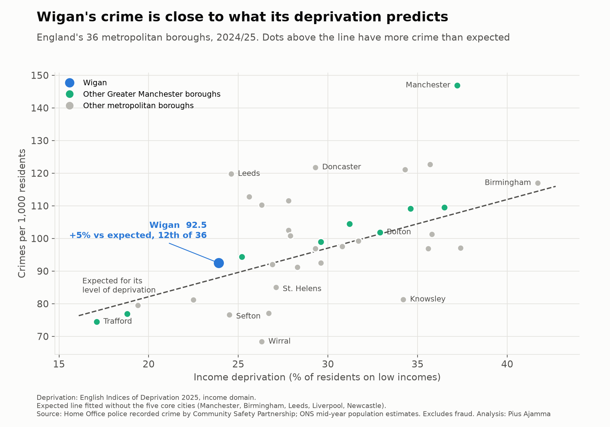
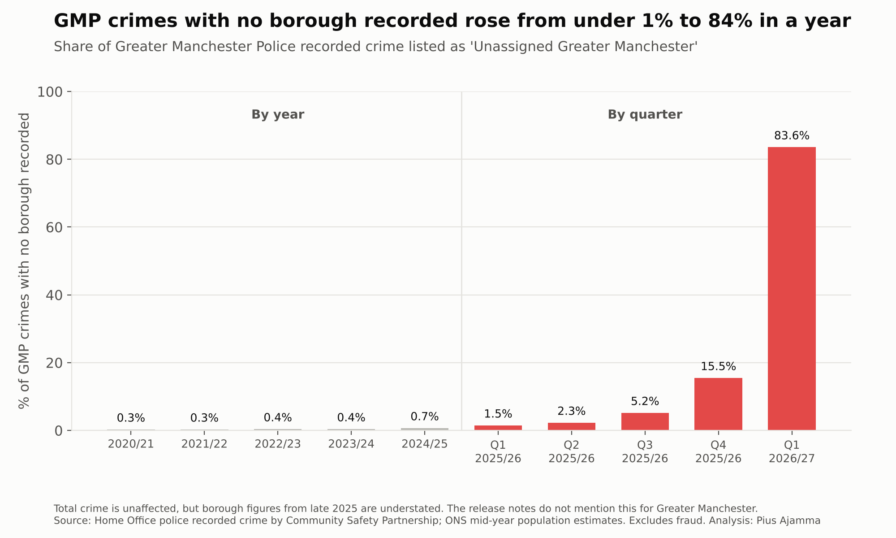
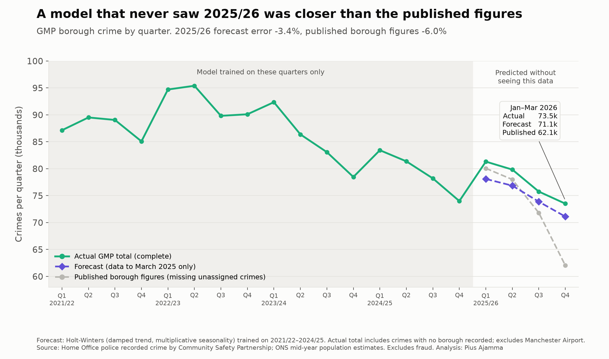

# Is Wigan's crime high?

An analysis of police recorded crime in the Wigan borough, 2020/21 to 2025/26, tested against deprivation and forecast to 2030/31, using only public data.

**📄 [Read the full report (PDF, 17 pages)](reports/Wigan_Crime_Report_2026.pdf)**

---

## The short answer

Wigan's recorded crime rate is **about 9% above the England and Wales average**. But that's largely what you'd expect for a large urban borough with its level of deprivation. Compared with England's 36 metropolitan boroughs, Wigan is **close to typical**. It has the **3rd lowest rate of Greater Manchester's 10 boroughs**, and since 2021/22 it has been **falling faster than the national rate**.



## Key findings

| | Wigan | Comparison | |
|---|---|---|---|
| 2024/25 vs England and Wales | 91.9 | 84.6 | **+9%** |
| 2024/25 vs Greater Manchester | 91.9 | 106.2 | **−13%** |
| 2024/25 vs Bolton (control borough) | 91.9 | 101.1 | **−9%** |
| vs expected for its deprivation, all English areas | 92.5 | 85.8 | +8% |
| **vs expected, 36 metropolitan boroughs only** | 92.5 | 88.0 | **+5% (12th of 36)** |
| Forecast 2026/27 | 90.6 (range 88–93) | | |

*Recorded crimes per 1,000 residents, excluding fraud. 2024/25 is the latest year with reliable borough figures (see below).*

- **Type of crime:** Wigan has more violence (+26%), public order offences (+48%) and criminal damage (+24%) than the national average, and less theft (−28%) and robbery (−31%). Violence and public order are the categories most affected by how police record crime.
- **Like with like:** controlling for income deprivation alone doesn't explain Wigan's gap. Comparing only with other big urban boroughs does: the gap falls to +5%. The biggest differences between places follow **police force boundaries**, not individual towns.



## Two gaps in public crime data

1. **Greater Manchester Police hasn't supplied street-level data to police.uk since July 2019** (GMP FOI 26.016219). Look Wigan up on police.uk today and you'll find almost nothing: about 10 crimes a month, mostly on the railway.
2. **From late 2025, GMP crimes increasingly weren't assigned to a borough.** The share rose from 0.7% in 2024/25 to 84% in April–June 2026. GMP's total crime is intact, but every borough's published figure from 2025/26 onwards is understated. The release notes don't mention this for Greater Manchester.



## The forecast was tested before it was trusted

A Holt-Winters model trained **only on data to March 2025** predicted GMP's 2025/26 total to within **3.4%**. The published borough figures fell **6.0%** short, and **15.6%** short by January–March 2026.



How the model was chosen:
- 3 simple models in a back-test, then 6 Holt-Winters designs plus a seasonal naive baseline, using **rolling-origin cross-validation** (18 forecasts per borough, no data after March 2025)
- the winning design was **damped trend with multiplicative seasonality** (6.0% average error, against 7.8% for the baseline)
- the forward forecasts use an **ensemble** (55% damped trend, 45% no trend, with the weight chosen on the same cross-validation)
- a **two-year test** showed error grows from 3% to 7%, so forecasts beyond two years are presented as **scenarios only**

All of this is in the report, including where choices were made after seeing results.

### Prospective check: January 2027

The forecast was saved on **22 October 2026**, before the next release. **GMP's total for July–September 2026 is forecast at 79,841** (expected within about ±3%). It'll be checked when the Home Office publishes in January 2027.

## Reproduce it

Requires Python 3.10+ and LibreOffice (to convert the 50 MB ODS file).

```bash
git clone https://github.com/dynamixAI/wigan-crime-analysis.git
cd wigan-crime-analysis
./run_pipeline.sh                  # sets up a venv, downloads the data, runs every stage
```

Or one stage at a time:

```bash
python -m wigan_crime.run --stages download
python -m wigan_crime.run --stages prepare analysis deprivation forecast charts
```

| Stage | What it does | Main outputs |
|---|---|---|
| `download` | Fetches the pinned sources and records SHA-256 checksums | `data/manifest.json` |
| `prepare` | Tidies 1.2m rows into quarterly tables; data checks | `outputs/gm_quarterly.csv`, `data_checks.csv` |
| `analysis` | Rates per 1,000, unassigned check, rankings, offence types | `annual_rates.csv`, `gm_ranking.csv`, `offence_groups.csv` |
| `deprivation` | Crime vs income deprivation for England; metropolitan comparison | `metropolitan_comparison.csv`, `deprivation_results.json` |
| `forecast` | Back-test, cross-validation, ensemble weight, 2025/26 test, forward forecast | `forecast_results.json`, `models/` |
| `charts` | All report charts | `outputs/charts/*.png` |

**Saved models.** `models/` holds the two fitted Holt-Winters models (pickle) and `model_card.json`, which lists their designs, fitted parameters, training data, ensemble weight, Wigan's share and the next check due.

**Testing without internet.** `tests/test_pipeline.sh` builds fake data with the real file layouts and runs every stage end to end.

**Note on revisions.** The Home Office and ONS revise their data. If your numbers differ slightly from the report, compare the checksums in `data/manifest.json`. Holt-Winters settings are found by numerical optimisation, so different versions of statsmodels or SciPy can also shift results slightly. `requirements.txt` pins the versions used for the report.

## Repository layout

```
wigan_crime/      pipeline code (config, download, prepare, analysis, deprivation, forecast, charts, run)
reports/          the PDF report, its charts, and the script that builds it
tests/            fake-data generator and end-to-end test
models/           saved models and model card (created by the forecast stage)
outputs/          tables and charts (created by the pipeline)
```

## Data sources

- Home Office, *Police recorded crime Community Safety Partnership open data tables*, year ending March 2021 to year ending June 2026 (updated 22 October 2026)
- ONS mid-year population estimates, via Nomis (NM_2002_1)
- English Indices of Deprivation 2025, File 10 v2 (income domain, because the overall index contains a crime domain)

Contains public sector information licensed under the [Open Government Licence v3.0](https://www.nationalarchives.gov.uk/doc/open-government-licence/version/3/).

## Limitations

These are recorded crimes, not all crime. The data is borough-level and quarterly, so it **can't** tell you about specific streets, the town centre or times of day. Part of the 2021–23 rise reflects GMP improving its recording after a 2020 inspection. The full list is in section 7 of the report.

---

*Analysis by Pius Ajamma, MSc Data Science. Questions and corrections welcome via Issues.*
